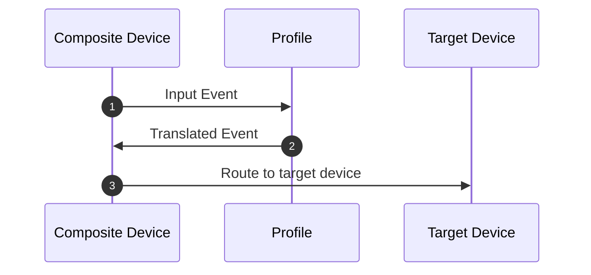
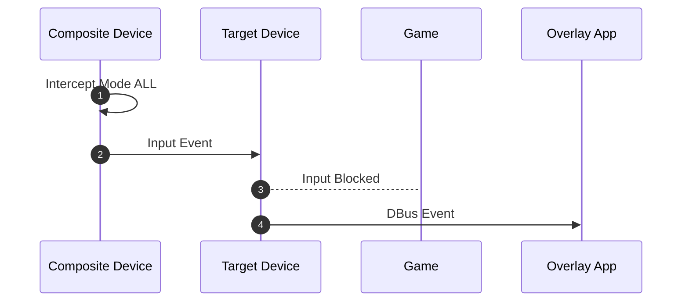
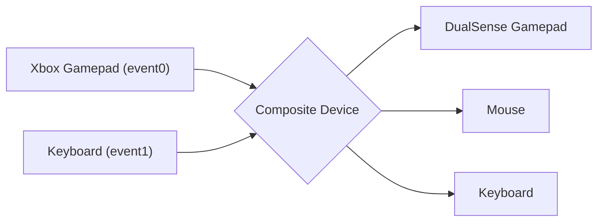
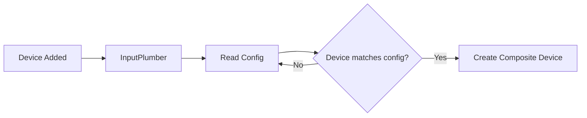

# Usage

When InputPlumber is running as a service, you can interact with it over DBus.
There are various DBus libraries available for popular programming languages
like Python, Rust, C++, etc.

You can also interface with DBus using the `busctl` command:

```bash
busctl tree org.shadowblip.InputPlumber
```

### Input Profiles

InputPlumber is capable of loading input device profiles to translate inputs into
any other supported input event. Input profiles are defined as YAML configuration
files that can be loaded on-demand for any device that InputPlumber manages. The
format of an input profile config is defined by the [Device Profile Schema](https://raw.githubusercontent.com/ShadowBlip/InputPlumber/main/rootfs/usr/share/inputplumber/schema/device_profile_v1.json) to make it easier to create profiles.



Typically input profiles should be generated using an external tool, but you
can manually create your own profiles using any text editor. If you use an editor
that supports the [YAML Language Server](https://github.com/redhat-developer/yaml-language-server)
you can write profiles with auto-complete and usage information.

Here is a short example:

```yaml
# yaml-language-server: $schema=https://raw.githubusercontent.com/ShadowBlip/InputPlumber/main/rootfs/usr/share/inputplumber/schema/device_profile_v1.json
version: 1
kind: DeviceProfile
name: Start Button to Escape Key
description: Profile to map a gamepad's start button to the Escape keyboard key

mapping:
  - name: Menu
    source_event:
      gamepad:
        button: Start
    target_events:
      - keyboard: KeyEsc
```

This example will remap the `Start` button from a gamepad to the `ESC` key.

To load the input profile, you can use the `LoadProfilePath` method on the input
device you want the profile applied to. You can also do this from the command
line using `busctl`:

```bash
busctl call org.shadowblip.InputPlumber \
  /org/shadowblip/InputPlumber/CompositeDevice0 \
  org.shadowblip.Input.CompositeDevice \
  LoadProfilePath "s" /usr/share/inputplumber/profiles/mouse_keyboard_wasd.yaml
```

### Intercept Mode

Intercept Mode is a feature of InputPlumber that can allow external applications
to intercept input events from an input device and re-route them over DBus
instead. The primary use case for this feature is typically to allow overlay
applications (like [OpenGamepadUI](https://github.com/ShadowBlip/OpenGamepadUI))
to stop input from reaching other running applications (like a game),
allowing the overlay to process inputs without those inputs leaking into other
running apps.



You can set the intercept mode by setting the `InterceptMode` property on the
input device you want to intercept input from. The intercept mode can be one
of three values:

- `0` (NONE) - No inputs are intercepted and re-routed
- `1` (PASS) - No inputs are intercepted and re-routed _except_ for gamepad `Guide` events. Upon receiving a gamepad `Guide` event, the device is automatically switched to intercept mode `2` (ALL).
- `2` (ALL) - All inputs are intercepted and re-routed over DBus
- `3` (GAMEPAD_ONLY) - All gamepad inputs are intercepted and re-routed over DBus

Typically the intercept mode should be handled by an external application, but
you can also set the intercept mode from the command line using `busctl`:

```bash
busctl set-property org.shadowblip.InputPlumber \
  /org/shadowblip/InputPlumber/CompositeDevice0 \
  org.shadowblip.Input.CompositeDevice \
  InterceptMode u 2
```

### Virtual Keyboard

When InputPlumber is running, a virtual keyboard is created that is used for
sending keyboard inputs. You can also use this keyboard to send keyboard events
using the DBus interface with the `SendKey` method. You can do this from the
command line using `busctl`:

```bash
busctl call org.shadowblip.InputPlumber \
  /org/shadowblip/InputPlumber/devices/target/keyboard0 \
  org.shadowblip.Input.Keyboard \
  SendKey sb KEY_ESC 1
```

### Device Compositing & Capability Maps

One feature of InputPlumber is the ability to combine multiple input devices
together into a single logical input device called a "Composite Device". This is
often required for many handheld gaming PCs that have built-in gamepads with
special non-standard buttons that show up as multiple independent input devices,
like a gamepad and a keyboard.




Composite devices are defined as YAML configuration files that follow the
[Composite Device Schema](https://raw.githubusercontent.com/ShadowBlip/InputPlumber/main/rootfs/usr/share/inputplumber/schema/composite_device_v1.json)
to combine the defined input devices together. When InputPlumber starts up, it
looks at all the input devices on the system and checks to see if they match a
composite device configuration. If they do, the input devices are combined into
a single logical composite device.



A composite device configuration looks like this:

```yaml
# yaml-language-server: $schema=https://raw.githubusercontent.com/ShadowBlip/InputPlumber/main/rootfs/usr/share/inputplumber/schema/composite_device_v1.json
version: 1
kind: CompositeDevice
name: OneXPlayer Intel

# Only check for source devices if *any* of the given data matches. If this list is
# empty, then the source devices will *always* be checked.
matches:
  - dmi_data:
      product_name: ONEXPLAYER
      sys_vendor: ONE-NETBOOK
      cpu_vendor: GenuineIntel
  - dmi_data:
      product_name: ONE XPLAYER
      sys_vendor: ONE-NETBOOK TECHNOLOGY CO., LTD.
      cpu_vendor: GenuineIntel

# One or more source devices to combine into a single virtual device. The events
# from these devices will be watched and translated according to the capability map.
source_devices:
  - group: gamepad
    evdev:
      name: OneXPlayer Gamepad
      phys_path: usb-0000:00:14.0-9/input0
  - group: keyboard
    evdev:
      name: AT Translated Set 2 keyboard
      phys_path: isa0060/serio0/input0

# The target input device(s) that will be created for this composite device
target_devices:
  - gamepad
  - mouse
  - keyboard

# The ID of a device capability mapping in the 'capability_maps' folder
capability_map_id: oxp1
```

In addition to combining multiple input devices together, composite devices can
also have a "Capability Map" to define the real capabilities of the input
device. This is commonly necessary for handheld gaming PCs where special
non-standard buttons will emit keyboard events (like `CTRL`+`ALT`+`DEL`) instead
of actual gamepad events.

Capability maps are defined in a separate YAML configuration file that follows
the [Capability Map Schema](https://raw.githubusercontent.com/ShadowBlip/InputPlumber/main/rootfs/usr/share/inputplumber/schema/capability_map_v2.json)
and are referenced by their unique ID.

A capability map configuration looks like this:

```yaml
# yaml-language-server: $schema=https://raw.githubusercontent.com/ShadowBlip/InputPlumber/main/rootfs/usr/share/inputplumber/schema/capability_map_v2.json
version: 2
kind: CapabilityMap
name: OneXPlayer Type 1
id: oxp1

# List of mapped events
mapping:
  - name: A to B
    source_events:
      - evdev:
          event_type: KEY
          event_code: BTN_SOUTH
          value_type: button
    target_event:
      gamepad:
        button: East

  - name: B to A
    source_events:
      - evdev:
          event_type: KEY
          event_code: BTN_EAST
          value_type: button
    target_event:
      gamepad:
        button: South

  - name: X + Y to Start
    mapping_type:
      evdev: chord
    source_events:
      - evdev:
          event_type: KEY
          event_code: BTN_WEST
          value_type: button
      - evdev:
          event_type: KEY
          event_code: BTN_NORTH
          value_type: button
    target_event:
      gamepad:
        button: Start

  - name: X to Y delay
    mapping_type:
      evdev: delayed_chord
    source_events:
      - evdev:
          event_type: KEY
          event_code: BTN_NORTH
          value_type: button
    target_event:
      gamepad:
        button: West
```

### Environment Variables

Some aspects of InputPlumber can be controlled with environment variables. This
is the current list of environment variables that are used:

| Variable | Default | Description |
| -------- | ------- | ----------- |
| `LOG_LEVEL` | info | Log level to use. Can be one of: 'error', 'warn', 'info', 'debug', 'trace' |
| `HIDE_DEVICES_FROM_ROOT` | 0 | Try to hide the device from elevated processes by moving the device node to `/dev/inputplumber/sources`. |
| `ENABLE_METRICS` | 0 | Enable input latency monitoring (debug builds only). Metrics can be viewed with `inputplumber device <id> target monitor <target>`. |
| `INSECURE_DISABLE_POLKIT` | 0 | Disable polkit authorization (NOT RECOMMENDED) |


### Troubleshooting

Find the InputPlumber version:

```bash
inputplumber --version
```
```
inputplumber 0.58.7
```

Start InputPlumber with debug logs enabled.

Temporarily:

```bash
sudo systemctl stop inputplumber
sudo LOG_LEVEL=debug inputplumber
```

Permanently:

```bash
sudo cp /usr/lib/systemd/system/inputplumber.service /etc/systemd/system/
sudo sed -i 's/LOG_LEVEL=info/LOG_LEVEL=debug/g' /etc/systemd/system/inputplumber.service
sudo systemctl daemon-reload
sudo systemctl restart inputplumber
```

View debug logs:

```bash
sudo journalctl --unit inputplumber.service
```

List managed devices:

```bash
inputplumber devices list
```
```
╭────┬───────────────╮
│ Composite Devices  │
├────┼───────────────┤
│ Id │ Name          │
├────┼───────────────┤
│ 0  │ ASUS ROG Ally │
╰────┴───────────────╯
Found 1 composite device(s)
```

View the current intercept mode for the first managed device:

```bash
inputplumber device 0 intercept get
```
```
Current intercept mode: none
```

Change the intercept mode of the first device:

```bash
inputplumber device 0 intercept set --help
inputplumber device 0 intercept set $MODE
```

View what InputPlumber profiles are loaded and what event interfaces are being used:

```bash
inputplumber device 0 info
```
```
╭────┬───────────────┬──────────────┬─────────────────────────────────────────────────────────────────────────────────────────────────────────╮
│ Composite Device                                                                                                                            │
├────┼───────────────┼──────────────┼─────────────────────────────────────────────────────────────────────────────────────────────────────────┤
│ Id │ Name          │ Profile Name │ Source Devices                                                                                          │
├────┼───────────────┼──────────────┼─────────────────────────────────────────────────────────────────────────────────────────────────────────┤
│ 0  │ ASUS ROG Ally │ Default      │ ["/dev/hidraw2", "/dev/input/event3", "/dev/input/event4", "/dev/input/event5", "/dev/iio:device0", ""] │
╰────┴───────────────┴──────────────┴─────────────────────────────────────────────────────────────────────────────────────────────────────────╯
```

Find the related configuration file (replace "ASUS ROG Ally" with the "Name" from the previous output):

```bash
grep --recursive --files-with-matches --basic-regexp "name: ASUS ROG Ally$" /usr/share/inputplumber/devices/
```
```
/usr/share/inputplumber/devices/50-rog_ally.yaml
```

Start the built-in test tool (recommended to run in a separate window):

```bash
inputplumber device 0 test
```

Validate the device's accelerometer and gyroscope (recommended to run in a separate
window). The tool walks through a series of poses and rotations, draws each one, and
reports whether the device measures the expected direction:

```bash
inputplumber device 0 test-imu
```

Every inertial sensor the device advertises is measured during the same step, so a
combined sensor and the sensors it is averaged from can be compared directly. A device
that advertises no accelerometer and no gyroscope says so and runs no steps. Measurement
windows are fixed periods of time (2 seconds for a pose, 3 seconds for a rotation), so the
result does not depend on how fast a device reports.

Sources that filter unchanged events go silent while the device is held still, so the
counts shown are deltas rather than a report rate. Rotation steps are judged from the
angle the gyro integrates across the window instead of from a mean angular rate: scaling
the sensor scales its mean too, so a scale error is invisible in a mean, while an
integrated angle has to match the rotation that was performed. When no motion arrives
during a window the step is judged from the mean angular rate instead, which can check the
axis and the direction but says nothing about scale.

A rotation step passes when the total lands within 22.5 degrees of the 90 degrees asked
for and the integrated rotation vector stays within 30 degrees of the instructed axis,
which also catches a turn made the wrong way or about the wrong axis. Gaps longer than
half a second contribute nothing, because silence from a delta filtered source means the
device stopped moving. A source that reports few deltas across a three second window
integrates less of the turn than was performed, so a low report rate can fail this step
for a sensor whose scale is correct. The total is shown live while measuring and in the
results list.

Everything happens on one screen that is re-rendered in place. The pose drawing occupies
the top region at every terminal width and folds itself to whatever rows are left, so a
terminal 80 columns by 24 rows shows the whole run without scrolling. Below it sits the
recommended configuration change, then the live reading of the current step and its verdict.

Pressing `n` on the last step moves one past it into the run's summary, which takes the
space the drawing had and lists every step with its verdict and reason. The summary
derives the mount matrices on arrival, so the change to make is in the results panel
without any further key press, and `p` returns to any step to measure it again. Nothing
is written to any file.

Keys: `s` measures the current step, `r` retries it, `n` and `p` move between steps and into
and out of the summary, `d` re-derives the matrices for the accelerometer and gyroscope of
every sensor without leaving the current step, and `q` (or `Esc`) leaves the test.


The measured samples arrive from the source driver, so they already carry any mount
matrix that is configured. A derived transform is therefore a correction on top of the
value configured today, and the recommendation states which file and key to change and
where the derived matrix differs from what is configured. An accelerometer gain is taken
from a pair of opposite resting poses, since one pose alone cannot tell a scale error from
a pose that was not held true.

An accelerometer group and a gyroscope group often need different transforms, because
their channels can arrive mirror-related. Whether a mirrored matrix is a defect depends on
what the matrix serves. Gravity is a single vector, so a mirrored set of accelerometer
channels still lands on the right canonical axis and nothing measured inside that group can
reveal the mirror, which means a determinant of `-1` on a source carrying one group only is
not a mistake. A source carrying both groups takes a single matrix for gravity and angular
rate at once, so that matrix has to be a proper rotation with a determinant of `+1`. Where
a device carries its two groups as two iio sources, each derived matrix is offered for its
own source:

```yaml
  - group: imu
    iio:
      name: accel_3d
    config:
      imu:
        mount_matrix:
          x: [0, -1, 0]
          y: [0, 0, 1]
          z: [-1, 0, 0]
  - group: imu
    iio:
      name: gyro_3d
    config:
      imu:
        mount_matrix:
          x: [1, 0, 0]
          y: [0, 0, 1]
          z: [0, 1, 0]
```

A device with a single inertial source has one matrix for both groups, so it can only be
right for one of them. A device whose inertial data arrives in a hidraw report has no
mount matrix at all, and the tool says so instead of offering a matrix; a wrong frame
there is corrected in that device's driver.

```yaml
  - group: gyroscope
    iio:
      name: "gyro-accel-3D"
    config:
      imu:
        mount_matrix:
          x: [0, -1, 0]
          y: [0, 0, 1]
          z: [-1, 0, 0]
```

While the tool runs the device is prepared for raw reading. A `debug` target is added to
the device's existing target list, intercept mode is turned off, event filters are
cleared, and the `debug` profile is loaded so that no inertial event is remapped. The
readings come from that debug target. The original target devices, intercept mode, event
filters and profile are saved beforehand and restored when the test ends.

View what input devices are being emulated for the first device:

```bash
inputplumber device 0 targets list
```
```
╭────────────┬───────────────────────────────╮
│ Target Devices                             │
├────────────┼───────────────────────────────┤
│ Id         │ Name                          │
├────────────┼───────────────────────────────┤
│ mouse      │ InputPlumber Mouse            │
├────────────┼───────────────────────────────┤
│ keyboard   │ InputPlumber Keyboard         │
├────────────┼───────────────────────────────┤
│ xbox-elite │ Microsoft X-Box One Elite pad │
╰────────────┴───────────────────────────────╯
```

View what events are being captured by InputPlumber:

```bash
sudo evtest
```
```
No device specified, trying to scan all of /dev/input/event*
Available devices:
/dev/input/event0:	Power Button
/dev/input/event1:	Sleep Button
/dev/input/event10:	HD-Audio Generic HDMI/DP,pcm=3
/dev/input/event11:	HD-Audio Generic Mic
/dev/input/event12:	HD-Audio Generic Mic
/dev/input/event13:	HD-Audio Generic Headphone
/dev/input/event14:	Microsoft X-Box One Elite 2 pad
/dev/input/event15:	InputPlumber Mouse
/dev/input/event16:	InputPlumber Keyboard
/dev/input/event2:	AT Translated Set 2 keyboard
/dev/input/event3:	Microsoft X-Box 360 pad
/dev/input/event4:	ROG Ally Keyboard
/dev/input/event5:	ROG Ally Mouse
/dev/input/event6:	NVTK0603:00 0603:F200
/dev/input/event7:	Video Bus
/dev/input/event8:	PC Speaker
/dev/input/event9:	Asus WMI hotkeys
Select the device event number [0-16]: 14
```

Stop InputPlumber and then view what events are being captured by the physical device:

```bash
sudo systemctl stop inputplumber
sudo evtest
```
```
No device specified, trying to scan all of /dev/input/event*
Available devices:
/dev/input/event0:	Power Button
/dev/input/event1:	Sleep Button
/dev/input/event10:	HD-Audio Generic HDMI/DP,pcm=3
/dev/input/event11:	HD-Audio Generic Mic
/dev/input/event12:	HD-Audio Generic Mic
/dev/input/event13:	HD-Audio Generic Headphone
/dev/input/event2:	AT Translated Set 2 keyboard
/dev/input/event3:	Microsoft X-Box 360 pad
/dev/input/event4:	ROG Ally Keyboard
/dev/input/event5:	ROG Ally Mouse
/dev/input/event6:	NVTK0603:00 0603:F200
/dev/input/event7:	Video Bus
/dev/input/event8:	PC Speaker
/dev/input/event9:	Asus WMI hotkeys
Select the device event number [0-13]: 3
```

