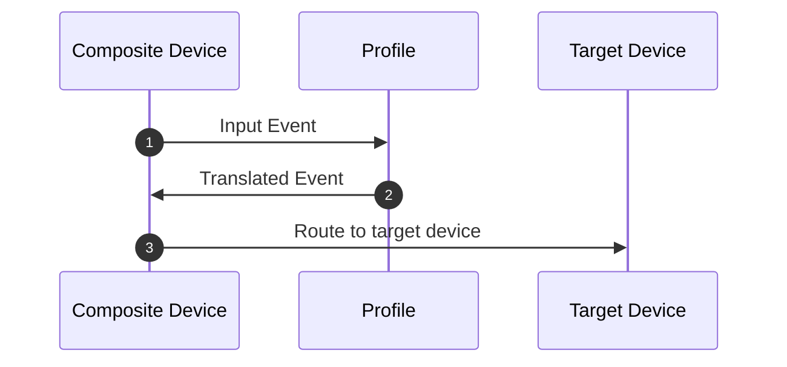
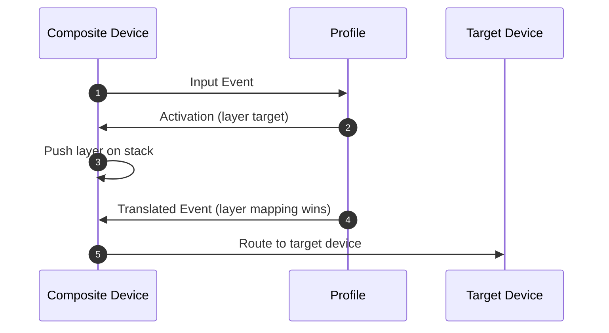
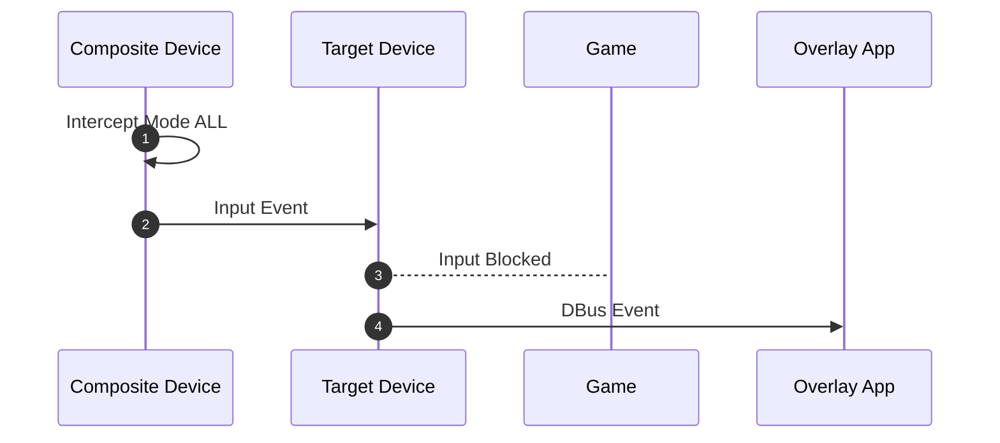
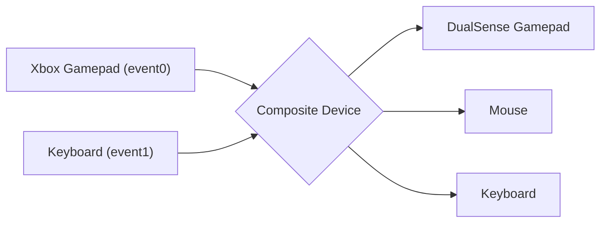
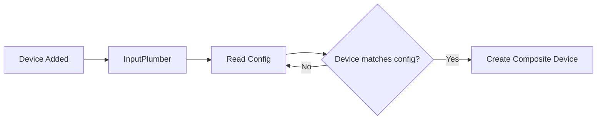

# Usage

When InputPlumber is running as a service, you can interact with it over DBus.
There are various DBus libraries available for popular programming languages
like Python, Rust, C++, etc.

You can also interface with DBus using the `busctl` command:

```bash
busctl tree org.shadowblip.InputPlumber
```

### Input Profiles

InputPlumber is capable of loading input device profiles to translate inputs into
any other supported input event. Input profiles are defined as YAML configuration
files that can be loaded on-demand for any device that InputPlumber manages. The
format of an input profile config is defined by the [Device Profile Schema](https://raw.githubusercontent.com/ShadowBlip/InputPlumber/main/rootfs/usr/share/inputplumber/schema/device_profile_v1.json) to make it easier to create profiles.



Typically input profiles should be generated using an external tool, but you
can manually create your own profiles using any text editor. If you use an editor
that supports the [YAML Language Server](https://github.com/redhat-developer/yaml-language-server)
you can write profiles with auto-complete and usage information.

Here is a short example:

```yaml
# yaml-language-server: $schema=https://raw.githubusercontent.com/ShadowBlip/InputPlumber/main/rootfs/usr/share/inputplumber/schema/device_profile_v1.json
version: 1
kind: DeviceProfile
name: Start Button to Escape Key
description: Profile to map a gamepad's start button to the Escape keyboard key

mapping:
  - name: Menu
    source_event:
      gamepad:
        button: Start
    target_events:
      - keyboard: KeyEsc
```

This example will remap the `Start` button from a gamepad to the `ESC` key.

To load the input profile, you can use the `LoadProfilePath` method on the input
device you want the profile applied to. You can also do this from the command
line using `busctl`:

```bash
busctl call org.shadowblip.InputPlumber \
  /org/shadowblip/InputPlumber/CompositeDevice0 \
  org.shadowblip.Input.CompositeDevice \
  LoadProfilePath "s" /usr/share/inputplumber/profiles/mouse_keyboard_wasd.yaml
```

### Input Layers

An input layer is a named set of input mappings that overrides the base mappings
of a profile while it is active. Layers let one profile carry a whole set of
alternative bindings (a "guide" chord layer, a mouse-mode layer, a rapid-fire
layer) and switch between them with ordinary inputs instead of loading a
different profile.



Activating a layer is just a mapping whose target event is a `layer` target:
`{ layer: { name: <string>, mode?: hold|toggle } }`. The `mode` describes how
the layer deactivates:

- **`hold`** (default): the layer is active while the activating input is held.
  Releasing the input pops the layer and releases anything it produced while
  held, so no key gets stuck.
- **`toggle`**: one press latches the layer on, the next press of the same input
  releases it. The layer survives the release of the activating input.

Layers **stack**. The most recently activated layer wins for a given source
event, so a layer activated later temporarily shadows an earlier one, and
releasing it uncovers the layer underneath. Layers can be activated in any
combination and a layer's own mappings may activate other layers. At most eight
layers stay active at once; activating a ninth drops the oldest one.

Here is a short example (see
[`layers_example.yaml`](https://github.com/ShadowBlip/InputPlumber/blob/main/rootfs/usr/share/inputplumber/profiles/layers_example.yaml)
for a complete profile):

```yaml
# yaml-language-server: $schema=https://raw.githubusercontent.com/ShadowBlip/InputPlumber/main/rootfs/usr/share/inputplumber/schema/device_profile_v1.json
version: 1
kind: DeviceProfile
name: Layers example

# The layer outputs need a mouse and keyboard target, and the base mappings
# need a gamepad target.
target_devices:
  - gamepad
  - keyboard
  - mouse

mapping:
  # Hold Guide to enable the mouse mode layer
  - name: Hold Guide for mouse mode
    source_event:
      gamepad:
        button: Guide
    target_events:
      - layer: { name: mouse_mode }

  # Press QuickAccess to latch the shortcuts layer, press it again to release it
  - name: QuickAccess latches the shortcuts layer
    source_event:
      gamepad:
        button: QuickAccess
    target_events:
      - layer: { name: shortcuts, mode: toggle }

  # Hold LeftBumper to enable the rapid layer
  - name: LeftBumper opens the rapid layer
    source_event:
      gamepad:
        button: LeftBumper
    target_events:
      - layer: { name: rapid }

layers:
  # Active while Guide is held: the right stick drives the mouse and the
  # triggers click.
  - name: mouse_mode
    mapping:
      - name: Guide+RightStick -> mouse
        source_event:
          gamepad:
            axis:
              name: RightStick
        target_events:
          - mouse:
              motion:
                speed_pps: 800

      - name: Guide+RightTrigger -> left click
        source_event:
          gamepad:
            trigger:
              name: RightTrigger
              deadzone: 0.2
        target_events:
          - mouse:
              button: Left

      - name: Guide+LeftTrigger -> right click
        source_event:
          gamepad:
            trigger:
              name: LeftTrigger
              deadzone: 0.2
        target_events:
          - mouse:
              button: Right

  - name: shortcuts
    mapping:
      - name: QuickAccess+South -> Esc
        source_event:
          gamepad:
            button: South
        target_events:
          - keyboard: KeyEsc

  # Stacks with the layers above: because the most recently activated layer
  # wins per source, pressing LeftBumper last makes South emit Space. If
  # `shortcuts` was activated after LeftBumper, South still emits Esc.
  - name: rapid
    mapping:
      - name: LB+South -> Space
        source_event:
          gamepad:
            button: South
        target_events:
          - keyboard: KeySpace
```

With this profile, holding `Guide` makes the right stick move the mouse and the
triggers click: right trigger is the left button, left trigger is the right
button, the same binding `mouse_keyboard_wasd.yaml` uses. Latching
`QuickAccess` and pressing `South` emits `Esc`; latching `QuickAccess`, then
holding `LeftBumper` and pressing `South` emits `Space` (the `rapid` layer was
activated last); releasing `LeftBumper` makes `South` emit `Esc` again. Note
that both the `shortcuts` and `rapid` layers remap `South`, which is exactly
what stacking is for.

A profile may set `target_devices`, which **replaces** the composite device's
target devices when the profile loads. The example sets `gamepad`, `keyboard`
and `mouse` because its layer outputs need those targets: with no mouse target
the mouse-mode mappings have nowhere to go, and the keyboard shortcuts are
dropped for the same reason. Omit the section to keep whatever targets the
composite already has, and list your usual gamepad target (e.g. `deck-uhid`)
instead of `gamepad` if you want to keep it.

Two caveats are worth knowing:

- Layer mappings apply **after** the device's capability map, like base profile
  mappings do. A layer can only remap a capability the composite device
  publishes after translation, so a layer mapping keyed on a raw source
  capability that the capability map renames will never match.
- A profile that uses layers loaded by an older version of InputPlumber has its
  `layers:` list and `layer` targets ignored silently: the older parser skips
  unknown fields, so the profile still loads but the layers simply do nothing.

### Intercept Mode

Intercept Mode is a feature of InputPlumber that can allow external applications
to intercept input events from an input device and re-route them over DBus
instead. The primary use case for this feature is typically to allow overlay
applications (like [OpenGamepadUI](https://github.com/ShadowBlip/OpenGamepadUI))
to stop input from reaching other running applications (like a game),
allowing the overlay to process inputs without those inputs leaking into other
running apps.



You can set the intercept mode by setting the `InterceptMode` property on the
input device you want to intercept input from. The intercept mode can be one
of three values:

- `0` (NONE) - No inputs are intercepted and re-routed
- `1` (PASS) - No inputs are intercepted and re-routed _except_ for gamepad `Guide` events. Upon receiving a gamepad `Guide` event, the device is automatically switched to intercept mode `2` (ALL).
- `2` (ALL) - All inputs are intercepted and re-routed over DBus
- `3` (GAMEPAD_ONLY) - All gamepad inputs are intercepted and re-routed over DBus

Typically the intercept mode should be handled by an external application, but
you can also set the intercept mode from the command line using `busctl`:

```bash
busctl set-property org.shadowblip.InputPlumber \
  /org/shadowblip/InputPlumber/CompositeDevice0 \
  org.shadowblip.Input.CompositeDevice \
  InterceptMode u 2
```

### Virtual Keyboard

When InputPlumber is running, a virtual keyboard is created that is used for
sending keyboard inputs. You can also use this keyboard to send keyboard events
using the DBus interface with the `SendKey` method. You can do this from the
command line using `busctl`:

```bash
busctl call org.shadowblip.InputPlumber \
  /org/shadowblip/InputPlumber/devices/target/keyboard0 \
  org.shadowblip.Input.Keyboard \
  SendKey sb KEY_ESC 1
```

### Device Compositing & Capability Maps

One feature of InputPlumber is the ability to combine multiple input devices
together into a single logical input device called a "Composite Device". This is
often required for many handheld gaming PCs that have built-in gamepads with
special non-standard buttons that show up as multiple independent input devices,
like a gamepad and a keyboard.




Composite devices are defined as YAML configuration files that follow the
[Composite Device Schema](https://raw.githubusercontent.com/ShadowBlip/InputPlumber/main/rootfs/usr/share/inputplumber/schema/composite_device_v1.json)
to combine the defined input devices together. When InputPlumber starts up, it
looks at all the input devices on the system and checks to see if they match a
composite device configuration. If they do, the input devices are combined into
a single logical composite device.



A composite device configuration looks like this:

```yaml
# yaml-language-server: $schema=https://raw.githubusercontent.com/ShadowBlip/InputPlumber/main/rootfs/usr/share/inputplumber/schema/composite_device_v1.json
version: 1
kind: CompositeDevice
name: OneXPlayer Intel

# Only check for source devices if *any* of the given data matches. If this list is
# empty, then the source devices will *always* be checked.
matches:
  - dmi_data:
      product_name: ONEXPLAYER
      sys_vendor: ONE-NETBOOK
      cpu_vendor: GenuineIntel
  - dmi_data:
      product_name: ONE XPLAYER
      sys_vendor: ONE-NETBOOK TECHNOLOGY CO., LTD.
      cpu_vendor: GenuineIntel

# One or more source devices to combine into a single virtual device. The events
# from these devices will be watched and translated according to the capability map.
source_devices:
  - group: gamepad
    evdev:
      name: OneXPlayer Gamepad
      phys_path: usb-0000:00:14.0-9/input0
  - group: keyboard
    evdev:
      name: AT Translated Set 2 keyboard
      phys_path: isa0060/serio0/input0

# The target input device(s) that will be created for this composite device
target_devices:
  - gamepad
  - mouse
  - keyboard

# The ID of a device capability mapping in the 'capability_maps' folder
capability_map_id: oxp1
```

In addition to combining multiple input devices together, composite devices can
also have a "Capability Map" to define the real capabilities of the input
device. This is commonly necessary for handheld gaming PCs where special
non-standard buttons will emit keyboard events (like `CTRL`+`ALT`+`DEL`) instead
of actual gamepad events.

Capability maps are defined in a separate YAML configuration file that follows
the [Capability Map Schema](https://raw.githubusercontent.com/ShadowBlip/InputPlumber/main/rootfs/usr/share/inputplumber/schema/capability_map_v2.json)
and are referenced by their unique ID.

A capability map configuration looks like this:

```yaml
# yaml-language-server: $schema=https://raw.githubusercontent.com/ShadowBlip/InputPlumber/main/rootfs/usr/share/inputplumber/schema/capability_map_v2.json
version: 2
kind: CapabilityMap
name: OneXPlayer Type 1
id: oxp1

# List of mapped events
mapping:
  - name: A to B
    source_events:
      - evdev:
          event_type: KEY
          event_code: BTN_SOUTH
          value_type: button
    target_event:
      gamepad:
        button: East

  - name: B to A
    source_events:
      - evdev:
          event_type: KEY
          event_code: BTN_EAST
          value_type: button
    target_event:
      gamepad:
        button: South

  - name: X + Y to Start
    mapping_type:
      evdev: chord
    source_events:
      - evdev:
          event_type: KEY
          event_code: BTN_WEST
          value_type: button
      - evdev:
          event_type: KEY
          event_code: BTN_NORTH
          value_type: button
    target_event:
      gamepad:
        button: Start

  - name: X to Y delay
    mapping_type:
      evdev: delayed_chord
    source_events:
      - evdev:
          event_type: KEY
          event_code: BTN_NORTH
          value_type: button
    target_event:
      gamepad:
        button: West
```

### Environment Variables

Some aspects of InputPlumber can be controlled with environment variables. This
is the current list of environment variables that are used:

| Variable | Default | Description |
| -------- | ------- | ----------- |
| `LOG_LEVEL` | info | Log level to use. Can be one of: 'error', 'warn', 'info', 'debug', 'trace' |
| `HIDE_DEVICES_FROM_ROOT` | 0 | Try to hide the device from elevated processes by moving the device node to `/dev/inputplumber/sources`. |
| `ENABLE_METRICS` | 0 | Enable input latency monitoring (debug builds only). Metrics can be viewed with `inputplumber device <id> target monitor <target>`. |
| `INSECURE_DISABLE_POLKIT` | 0 | Disable polkit authorization (NOT RECOMMENDED) |


### Troubleshooting

Find the InputPlumber version:

```bash
inputplumber --version
```
```
inputplumber 0.58.7
```

Start InputPlumber with debug logs enabled.

Temporarily:

```bash
sudo systemctl stop inputplumber
sudo LOG_LEVEL=debug inputplumber
```

Permanently:

```bash
sudo cp /usr/lib/systemd/system/inputplumber.service /etc/systemd/system/
sudo sed -i 's/LOG_LEVEL=info/LOG_LEVEL=debug/g' /etc/systemd/system/inputplumber.service
sudo systemctl daemon-reload
sudo systemctl restart inputplumber
```

View debug logs:

```bash
sudo journalctl --unit inputplumber.service
```

List managed devices:

```bash
inputplumber devices list
```
```
╭────┬───────────────╮
│ Composite Devices  │
├────┼───────────────┤
│ Id │ Name          │
├────┼───────────────┤
│ 0  │ ASUS ROG Ally │
╰────┴───────────────╯
Found 1 composite device(s)
```

View the current intercept mode for the first managed device:

```bash
inputplumber device 0 intercept get
```
```
Current intercept mode: none
```

Change the intercept mode of the first device:

```bash
inputplumber device 0 intercept set --help
inputplumber device 0 intercept set $MODE
```

View what InputPlumber profiles are loaded and what event interfaces are being used:

```bash
inputplumber device 0 info
```
```
╭────┬───────────────┬──────────────┬─────────────────────────────────────────────────────────────────────────────────────────────────────────╮
│ Composite Device                                                                                                                            │
├────┼───────────────┼──────────────┼─────────────────────────────────────────────────────────────────────────────────────────────────────────┤
│ Id │ Name          │ Profile Name │ Source Devices                                                                                          │
├────┼───────────────┼──────────────┼─────────────────────────────────────────────────────────────────────────────────────────────────────────┤
│ 0  │ ASUS ROG Ally │ Default      │ ["/dev/hidraw2", "/dev/input/event3", "/dev/input/event4", "/dev/input/event5", "/dev/iio:device0", ""] │
╰────┴───────────────┴──────────────┴─────────────────────────────────────────────────────────────────────────────────────────────────────────╯
```

Find the related configuration file (replace "ASUS ROG Ally" with the "Name" from the previous output):

```bash
grep --recursive --files-with-matches --basic-regexp "name: ASUS ROG Ally$" /usr/share/inputplumber/devices/
```
```
/usr/share/inputplumber/devices/50-rog_ally.yaml
```

Start the built-in test tool (recommended to run in a separate window):

```bash
inputplumber device 0 test
```

View what input devices are being emulated for the first device:

```bash
inputplumber device 0 targets list
```
```
╭────────────┬───────────────────────────────╮
│ Target Devices                             │
├────────────┼───────────────────────────────┤
│ Id         │ Name                          │
├────────────┼───────────────────────────────┤
│ mouse      │ InputPlumber Mouse            │
├────────────┼───────────────────────────────┤
│ keyboard   │ InputPlumber Keyboard         │
├────────────┼───────────────────────────────┤
│ xbox-elite │ Microsoft X-Box One Elite pad │
╰────────────┴───────────────────────────────╯
```

View what events are being captured by InputPlumber:

```bash
sudo evtest
```
```
No device specified, trying to scan all of /dev/input/event*
Available devices:
/dev/input/event0:	Power Button
/dev/input/event1:	Sleep Button
/dev/input/event10:	HD-Audio Generic HDMI/DP,pcm=3
/dev/input/event11:	HD-Audio Generic Mic
/dev/input/event12:	HD-Audio Generic Mic
/dev/input/event13:	HD-Audio Generic Headphone
/dev/input/event14:	Microsoft X-Box One Elite 2 pad
/dev/input/event15:	InputPlumber Mouse
/dev/input/event16:	InputPlumber Keyboard
/dev/input/event2:	AT Translated Set 2 keyboard
/dev/input/event3:	Microsoft X-Box 360 pad
/dev/input/event4:	ROG Ally Keyboard
/dev/input/event5:	ROG Ally Mouse
/dev/input/event6:	NVTK0603:00 0603:F200
/dev/input/event7:	Video Bus
/dev/input/event8:	PC Speaker
/dev/input/event9:	Asus WMI hotkeys
Select the device event number [0-16]: 14
```

Stop InputPlumber and then view what events are being captured by the physical device:

```bash
sudo systemctl stop inputplumber
sudo evtest
```
```
No device specified, trying to scan all of /dev/input/event*
Available devices:
/dev/input/event0:	Power Button
/dev/input/event1:	Sleep Button
/dev/input/event10:	HD-Audio Generic HDMI/DP,pcm=3
/dev/input/event11:	HD-Audio Generic Mic
/dev/input/event12:	HD-Audio Generic Mic
/dev/input/event13:	HD-Audio Generic Headphone
/dev/input/event2:	AT Translated Set 2 keyboard
/dev/input/event3:	Microsoft X-Box 360 pad
/dev/input/event4:	ROG Ally Keyboard
/dev/input/event5:	ROG Ally Mouse
/dev/input/event6:	NVTK0603:00 0603:F200
/dev/input/event7:	Video Bus
/dev/input/event8:	PC Speaker
/dev/input/event9:	Asus WMI hotkeys
Select the device event number [0-13]: 3
```

